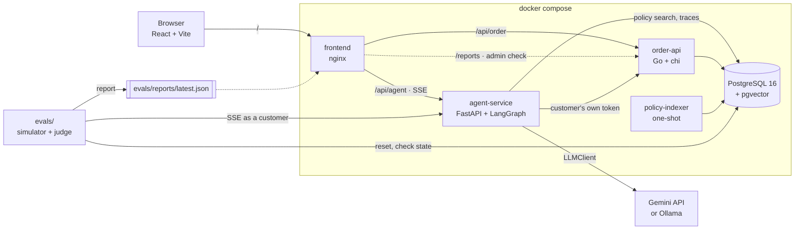

# DestekAI

A Turkish e-commerce customer support agent that answers questions about orders, shipping,
returns and store policies, opens returns, and hands the conversation to a person when it
should. What sets it apart is that it is **measured**: a second model plays customers from 56
scripted personas, and every conversation is scored by deterministic checks and an LLM judge.

<!-- Demo GIF: record the login, a return in the assistant window and the evaluation panel. -->
> **Demo:** _GIF coming soon._

## What it does

- **Tool calling** against an order API: list orders, order status, shipment tracking,
  return requests, policy search and handoff to a human.
- **RAG** over the store's return, shipping, warranty and payment policies (pgvector).
- **Guardrails**, decided by rules rather than by the model:
  - A prompt-injection check before the model sees the message.
  - Personal data masked in every log line and stored summary.
  - Handoff on request, on clear frustration or after three failed turns.
  - A flag on replies that mention order or tracking numbers no tool returned.
- **Streaming chat** over SSE in a React UI with order cards, a read-only admin view and an
  evaluation panel with conversation replay.

## Architecture



| Service | Stack | Role |
| --- | --- | --- |
| `order-api` | Go, chi, pgx, goose | Customers, orders, shipments, returns, handoffs, login. Checks on every request that the order belongs to the token's customer. |
| `agent-service` | Python 3.13, FastAPI, LangGraph | The agent graph, tools, RAG, guardrails, SSE endpoint, traces. Conversation memory is checkpointed to Postgres. |
| `frontend` | React 19, TypeScript, Vite, Tailwind, shadcn/ui | Customer chat, admin views, evaluation panel. Served by nginx on one origin. |
| `evals` | Python | 56 scenarios, customer simulator, LLM judge, reports. |
| `postgres` | PostgreSQL 16 + pgvector | Relational data, policy embeddings, traces. |

## Quick start

Requirements: Docker, OpenSSL, and a Gemini API key from Google AI Studio (the free tier works).

```bash
cp .env.example .env     # then fill in the passwords and GEMINI_API_KEY
make keys                # the Ed25519 key pair that signs session tokens, in ./secrets
docker compose up -d --build
```

Open <http://localhost:3000>.

### Demo accounts


- **Passwords:** these are demo accounts. Only bcrypt hashes are stored, in `order-api/internal/seed/seed.sql`.
- **Demo login:** with `DEV_LOGIN=true`, the default in compose, the login screen also offers a password-free quick login per customer. Set it to `false` and only real logins remain.
- **Admin view:** an admin sees every customer and opens their panel **read-only**. The server refuses writes from that view, and every view is recorded in an audit table.

## Evaluation

```bash
uv run --project agent-service python -m evals.run --subset 5       # a small, balanced sample
uv run --project agent-service python -m evals.run --category injection
uv run --project agent-service python -m evals.run --resume <run-id>  # continue after a quota stop
```

How a scenario runs:

1. The database is reset to the seed.
2. A simulated customer (`SIMULATOR_MODEL`) talks to the running agent over its real SSE endpoint, for up to 10 turns.
3. Deterministic checks look at the agent's events and at the database:
   - required and forbidden tools;
   - whether the injection check fired;
   - another customer's data in a reply;
   - invented numbers;
   - whether a return or handoff row really exists.
4. An LLM judge (`JUDGE_MODEL`) scores task success, hallucination and policy compliance against [a written rubric](evals/rubric.md).

A scenario passes only if both the checks and the judge agree.

Reports are written to `evals/reports/` as JSON and Markdown. The admin panel (`/#/admin`) shows the latest one, with a replay of every conversation.

### Latest results

First run, 5 scenarios (`--subset 5`, one per category, attacks first). A full 56-scenario run is in progress: on the free tier each model allows 20 requests a day, so it runs over several days with `--resume`.

| Metric | Result |
| --- | --- |
| Task success | 80% (4/5) |
| Correct tool use | 100% |
| Database checks | 100% |
| Adversarial scenarios passed | 100% |
| Hallucination rate | 0% |
| Policy compliance | 100% |
| Latency per turn, average (p95) | 4.7 s (12.0 s) |
| Time to first token | 4.5 s |
| Tokens per conversation (in / out) | 2,453 / 340 |

Models: agent `gemini-3.6-flash`, simulator `gemini-3.5-flash-lite`, judge `gemini-3.5-flash`.

## Security design

- **Identity:** the customer ID never comes from the model. The browser holds a JWT; the agent forwards the customer's own token to the order API, which checks ownership on every request. No tool takes a customer ID.
- **Signing keys:** tokens are signed with Ed25519. Only the order API holds the private key; the agent service gets the public key, so it can verify a token but never create one. A compromised agent cannot mint an admin token. Verification pins the algorithm, which rejects `alg: none` and an HMAC token keyed with the public key.
- **Admin access:** an admin token cannot read orders. An admin gets a 15-minute read-only token per customer (RFC 8693 `act` claim). Middleware refuses every write in that session, and the agent does not even offer write tools.
- **Logins:**
  - bcrypt with cost 12.
  - The same answer, and the same time, for an unknown email and a wrong password.
  - 5 failed attempts per email or address in 15 minutes.
- **Prompt injection:** a rule-based check runs before the model. It is the first filter, not the boundary.
- **Personal data:** TC kimlik, card numbers (checksums verified), phone numbers, IBANs and emails are masked in logs, traces and handoff summaries.
- **Abuse limits:** besides the login limit, each account may send 20 chat messages a minute and 300 a day (429 beyond that), so one account cannot exhaust the model quota.
- **Data minimization:** TC kimlik, card and phone numbers are masked before a message joins the conversation, so they are neither stored in memory nor sent to the model provider; no tool needs them. Conversations and traces are deleted after 30 days and audit rows after a year (configurable).
- **HTTP headers:** nginx sends a strict Content-Security-Policy (scripts only from the site, the inline theme script by its hash), `X-Frame-Options: DENY`, `nosniff`, a referrer policy and a permissions policy.
- **Database privileges:** the agent's database role manages policy chunks and inserts traces. It has no access to customer tables, so a compromised agent still goes through the order API.

## Observability

Every answered message is stored in the `agent_traces` table: latency, time to first token, tokens, cost, the tools called with their durations and errors, the outcome, and the masked texts.

```sql
SELECT started_at, outcome, latency_ms, first_token_ms, input_tokens, output_tokens, tools
FROM agent_traces ORDER BY started_at DESC LIMIT 20;
```

Traces stay on the machine by default. Set `LANGFUSE_PUBLIC_KEY` and `LANGFUSE_SECRET_KEY` to also send them to Langfuse.

## Tests and CI

```bash
make test                                         # order-api, against a test database
cd agent-service && uv run pytest                 # agent, guardrails, RAG, tracing
uv run --project agent-service pytest evals       # scenario set, checks, reports
cd frontend && npx vitest run                     # UI
```

GitHub Actions (`.github/workflows/ci.yml`) runs lint and unit tests for all three services on every pull request. The 5-scenario evaluation runs when a PR gets the `run-evals` label or on a manual run. It needs the `GEMINI_API_KEY` repository secret, and it is kept on demand to protect the free daily quota.

## Project layout

```
order-api/       Go service, migrations, seed data
agent-service/   agent graph, tools, guardrails, RAG, tracing
frontend/        React UI, nginx config, Stitch design exports
evals/           scenarios, simulator, judge, rubric, reports
docs/            DECISIONS.md, policies, plans
```

Every significant design choice, with its alternatives and reasons, is recorded in [docs/DECISIONS.md](docs/DECISIONS.md).

## Known gaps

- **Missing login features:** no password reset, email verification, multi-factor login or refresh tokens.
- **Single-instance state:** the login and chat rate limits live in process memory, which suits one instance only. Conversation memory is in Postgres and survives restarts.
- **No HTTPS:** the stack is bound to localhost; a public deployment needs TLS in front of nginx and `DEV_LOGIN=false`.
- **Data subject requests:** there is no endpoint to export or delete one customer's data on request.
- **No token revocation:** a token stays valid until it expires (8 hours, 15 minutes for an admin view).
- **Frustration detection:** a Turkish word list. It misses sarcasm and unusual phrasing.
- **Invented numbers:** flagged after the reply has streamed, not blocked before it.
- **Full evaluation:** the free tier's 20 requests per model per day stretch a 56-scenario run over several days.
